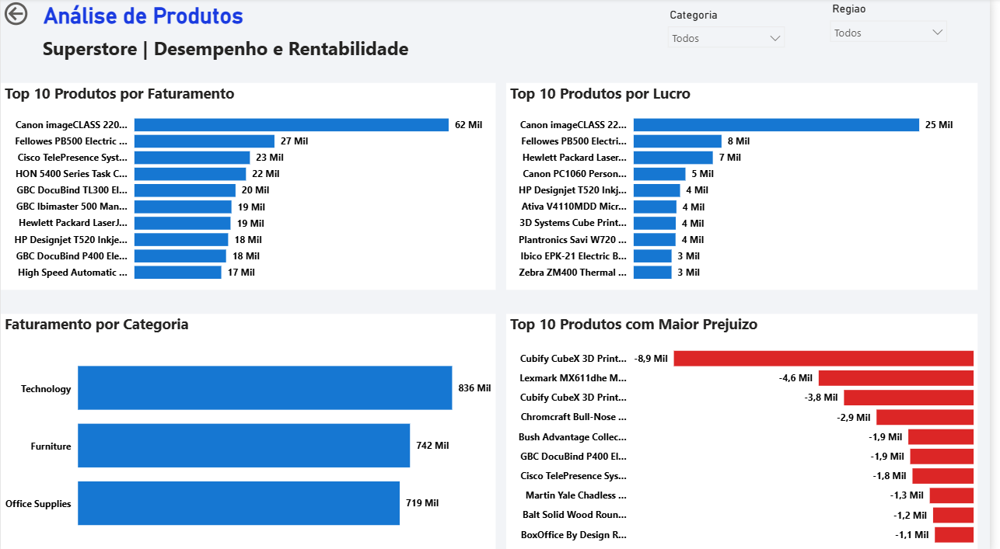
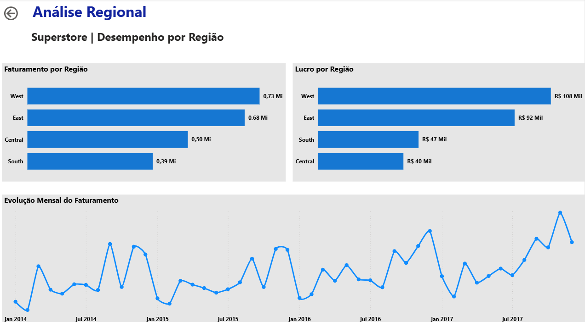
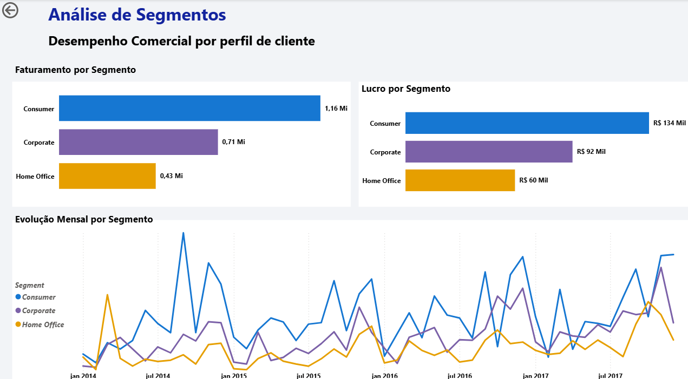

# Superstore — Business Intelligence & Sales Analytics

Projeto de Business Intelligence desenvolvido para analisar o desempenho comercial da base Sample Superstore, transformando dados de vendas em informações relevantes para apoiar a tomada de decisão.

O projeto integra Python, Pandas, SQL Server e Power BI, abrangendo preparação de dados, consultas SQL, modelagem de dados, indicadores e visualizações interativas.

## 🎯 Objetivos

- Analisar faturamento, lucro, margem de lucro, quantidade de pedidos e ticket médio.
- Identificar produtos com melhor desempenho e produtos que geram prejuízo.
- Comparar resultados entre regiões geográficas.
- Avaliar o desempenho dos segmentos de clientes.
- Acompanhar a evolução mensal das vendas e comparar períodos.

## 🛠️ Tecnologias utilizadas

- **Python e Pandas:** leitura, preparação e tratamento dos dados.
- **SQLAlchemy:** integração entre Python e SQL Server.
- **SQL Server:** armazenamento dos dados e criação de views SQL.
- **Power BI:** desenvolvimento do dashboard interativo.
- **DAX:** criação de medidas e indicadores.
- **Modelagem de dados:** organização dos relacionamentos e utilização de tabela calendário.

## 📊 Dashboard Power BI

O relatório contém quatro páginas analíticas.

### 1. Visão Executiva

Visão geral dos principais indicadores, incluindo faturamento, lucro, margem, pedidos e ticket médio, com análises comparativas do desempenho comercial.


### 2. Análise de Produtos

Análise dos produtos com maior faturamento, maior lucro e maiores prejuízos, além da comparação por categoria.



### 3. Análise Regional

Comparação do faturamento e do lucro entre as regiões, acompanhada da evolução mensal das vendas.



### 4. Análise de Segmentos

Avaliação do faturamento e do lucro dos segmentos Consumer, Corporate e Home Office, incluindo sua evolução mensal.



## 🔄 Etapas do projeto

1. Leitura da base de dados com Python e Pandas.
2. Inspeção, limpeza e preparação dos dados.
3. Padronização dos nomes das colunas e tratamento dos tipos de dados.
4. Carga dos dados no SQL Server utilizando SQLAlchemy.
5. Criação de views SQL para apoiar as análises.
6. Modelagem dos dados no Power BI, incluindo a tabela calendário.
7. Criação de medidas DAX, indicadores e visualizações.
8. Desenvolvimento e organização das quatro páginas do dashboard.

## 🗄️ Scripts SQL

Os scripts estão disponíveis na pasta `SQL/`:

- `vw_kpis_superstore.sql`: consolidação de indicadores por região, categoria e segmento.
- `vw_produtos_superstore.sql`: indicadores de vendas e lucro por produto e categoria.
- `vw_vendas_mensais.sql`: agregação dos indicadores por ano e mês.

## 🐍 Script Python


### Instalação das dependências

Certifique-se de ter o Python instalado. No terminal, execute:

```bash
pip install -r requirements.txt
```

Para executar o ETL, configure as variáveis de ambiente necessárias para o caminho do CSV e a conexão com o SQL Server antes de executar o script.


O script `Python/etl_superstore.py` demonstra o processo de ETL utilizado para ler o CSV, tratar os dados e carregá-los no SQL Server.

Para executá-lo, é necessário configurar o ambiente local, instalar as dependências e ajustar o caminho do CSV e as variáveis de conexão ao SQL Server.

## 💡 Principais aprendizados

- Integração entre Python e SQL Server.
- Preparação e transformação de dados para análise.
- Escrita de consultas SQL e criação de views.
- Modelagem de dados e criação de medidas DAX.
- Desenvolvimento de dashboards interativos.
- Análise de indicadores comerciais e apresentação visual de resultados.

## 📂 Estrutura do repositório

```text
superstore-business-intelligence/
├── README.md
├── imagens/
│   ├── 01-visao-executiva.png
│   ├── 02-produtos..png
│   ├── 03-regioes..png
│   └── 04-segmentos..png
├── Python/
│   └── etl_superstore.py
└── SQL/
    ├── vw_kpis_superstore.sql
    ├── vw_produtos_superstore.sql
    └── vw_vendas_mensais.sql
```

## 👨‍💻 Sobre o projeto

Este projeto faz parte do meu portfólio de estudos em Análise de Dados e Business Intelligence, com foco no desenvolvimento de habilidades técnicas e analíticas aplicadas a problemas de negócio.

**Áreas de interesse:** Análise de Dados, Business Intelligence e desenvolvimento de dashboards.

