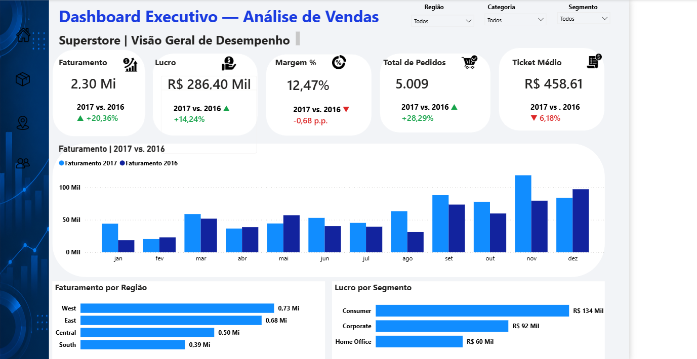

# superstore-business-intelligence
Projeto de análise de vendas com Python, Pandas, SQL Server e Power BI.
# 📊 Superstore — Business Intelligence & Sales Analytics

## Sobre o projeto

Projeto de Business Intelligence desenvolvido para analisar o desempenho comercial da base Sample Superstore, transformando dados de vendas em informações relevantes para apoiar a tomada de decisão.

O projeto contempla preparação de dados com Python, armazenamento e consultas no SQL Server e desenvolvimento de um dashboard interativo no Power BI.

## 🎯 Objetivos

- Analisar faturamento, lucro, margem de lucro, quantidade de pedidos e ticket médio.
- Identificar produtos com melhor desempenho e produtos que geram prejuízo.
- Comparar resultados entre regiões geográficas.
- Avaliar o desempenho dos diferentes segmentos de clientes.
- Acompanhar a evolução mensal das vendas e comparar períodos.

## 🛠️ Tecnologias utilizadas

- **Python:** preparação e tratamento dos dados.
- **Pandas:** manipulação e análise dos dados.
- **SQLAlchemy:** conexão entre Python e SQL Server.
- **SQL Server:** armazenamento dos dados, consultas SQL e criação de views.
- **Power BI:** criação do dashboard interativo.
- **DAX:** criação de medidas e indicadores.
- **Modelagem de dados:** organização dos dados e relacionamento com a tabela calendário.

## 📈 Dashboard

O relatório foi organizado em quatro páginas:

## 📈 Dashboard Interativo

O dashboard foi desenvolvido no Power BI e está organizado em quatro páginas para explorar diferentes perspectivas do desempenho comercial.

### 1. Visão Executiva

Visão geral dos principais indicadores: faturamento, lucro, margem, pedidos e ticket médio, com comparação anual e análise por região e segmento.



### 2. Análise de Produtos

Análise dos produtos com maior faturamento, maior lucro e maiores prejuízos, além da comparação de faturamento por categoria.


### 3. Análise Regional

Comparação do faturamento e do lucro entre as regiões, acompanhada da evolução mensal das vendas.


### 4. Análise de Segmentos

Avaliação do faturamento e do lucro dos segmentos Consumer, Corporate e Home Office, incluindo sua evolução mensal.


## 🔄 Etapas do projeto

1. Leitura da base de dados com Python e Pandas.
2. Inspeção, limpeza e preparação dos dados.
3. Padronização dos nomes das colunas e tratamento dos tipos de dados.
4. Carga dos dados no SQL Server utilizando SQLAlchemy.
5. Criação de consultas e views SQL para apoiar as análises.
6. Modelagem dos dados no Power BI, incluindo a tabela calendário.
7. Criação de medidas DAX, indicadores e visualizações interativas.
8. Desenvolvimento e organização das quatro páginas do dashboard.

## 💡 Principais aprendizados

- Integração entre Python e SQL Server.
- Preparação e transformação de dados para análise.
- Escrita de consultas SQL e criação de views.
- Modelagem de dados e criação de medidas DAX.
- Desenvolvimento de dashboards interativos.
- Análise de indicadores comerciais e apresentação visual de resultados.

## 📂 Estrutura do repositório

```text
superstore-business-intelligence/
├── README.md
├── .gitignore
├── imagens/
├── python/
└── sql/
```

## 👨‍💻 Sobre o projeto

Este projeto faz parte do meu portfólio de estudos em Análise de Dados e Business Intelligence, com foco no desenvolvimento de habilidades técnicas e analíticas aplicadas a problemas de negócio.

**Áreas de interesse:** Análise de Dados, Business Intelligence e desenvolvimento de dashboards.

